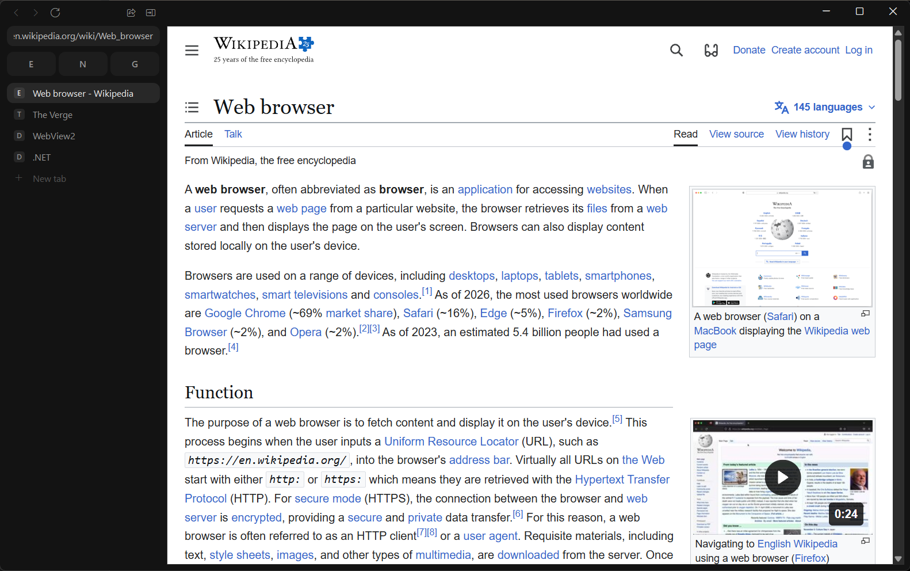

# browse

Windows port of [Office Commun's Search](https://github.com/driceroland/Search), built with WinForms on .NET 10 and the system Microsoft Edge WebView2 runtime. It does not bundle Chromium, Electron, or .NET, so the download is a single small `browse.exe`.



## Download

Get `browse.exe` from the [latest release](https://github.com/slyim/browse/releases/latest), unzip, and run it. Needs the .NET 10 Desktop Runtime (see below).

## Requirements

- Windows 10 or Windows 11 (x64)
- [.NET 10 Desktop Runtime (x64)](https://dotnet.microsoft.com/download/dotnet/10.0)
- Microsoft Edge WebView2 Runtime (preinstalled on Windows 11 and most Windows 10 installations)
- For building and testing: .NET 10 SDK and Python 3

## Build, run, and test

From the folder containing `Search.Windows.csproj`:

```powershell
dotnet run
dotnet publish Search.Windows.csproj -c Release -warnaserror -o publish
python test_smoke.py publish/browse.exe
```

`test_smoke.py` launches the built executable against a local loopback fixture in a temporary profile and verifies navigation, URL resolution, tab layouts, custom title bar hit-testing, tracker/ad blocking (on and off), link cleaning (on and off), settings persistence, Phosphor icon font loading, session save/restore (including multi-instance lock behavior), sleeping tabs, and one-time Share delivery.

## Features

- **Session restore with lazy tabs**: Restores open and pinned tabs, the active tab, and the tab layout on startup. Only the selected tab creates a WebView2 and loads until you switch to other tabs. A per-profile mutex lets a second window open and restore without overwriting the first window's `session.json`.
- **Sidebar or top tab strip**: Switch between the vertical sidebar (with a pinned-tab tile grid) and the horizontal top tab strip via **Settings** (`Ctrl+,`) or `Ctrl+Shift+S`. Right-click a tab to pin, unpin, or close it; pinned tabs cannot be closed until unpinned.
- **Settings**: Open **Settings** from the toolbar gear button or with `Ctrl+,` to choose theme (**System**, **Light**, or **Dark**, applied on next launch), switch tab layout (**Sidebar** or **Top tabs**), toggle ad & tracker blocking, link cleaning, sleeping tabs, automatic update checks, and the toolbar Share button, clear WebView2 browsing data (cookies, cache, history, and site data), and view the app version.
- **Light and dark mode**: Follows the Windows system light/dark setting by default, or can be pinned to Light or Dark in **Settings**.
- **Custom title bar**: Integrated minimize/maximize/close buttons and draggable window chrome.
- **Tracker/ad blocking and link cleaning**: Blocks requests to common third-party ad/tracker domains, hides common ad containers via CSS, and strips tracking query parameters (`utm_*`, `fbclid`, `gclid`, etc., plus `si` on YouTube and Spotify) while leaving signed URLs intact. Both can be toggled in **Settings**.
- **Sleeping tabs**: Suspends idle background tabs after 5 minutes to lower memory usage (skipping active, pinned, navigating, and audio-playing tabs) and resumes them when selected. Can be toggled in **Settings**.
- **One-time read-only Share**: Offers a one-time JSON snapshot (`{ url, title, text }`) of the active HTTP/HTTPS page over a local named pipe (`SearchWindows-<hex>`). Can be hidden from the toolbar in **Settings**. A local tool can read it with:

  ```powershell
  .\read-page.ps1 -Name 'SearchWindows-<code-shown-in-the-dialog>'
  ```

  **Security note**: While the offer is open (up to 60 seconds, once), **any program running as you** can enumerate and read the snapshot from the pipe — share only when you trust what is running. Capture is read-only (strips URL query and fragment, skips form inputs and hidden elements, caps text length, and exposes no cookies, storage, or tab control), but it is not a general PII/secret scrubber and page text should be treated as untrusted by any receiving agent.

## Keyboard shortcuts

| Shortcut | Action |
| --- | --- |
| `Ctrl+L` | Focus address bar |
| `Esc` | Cancel address bar edit and return focus to the page |
| `Ctrl+T` | New tab |
| `Ctrl+W` | Close current tab (unpinned) |
| `Ctrl+Shift+T` | Reopen last closed tab |
| `Ctrl+Shift+S` | Toggle sidebar / top tab strip |
| `Ctrl+,` | Open Settings |
| `Ctrl+1`–`Ctrl+8` | Switch to tab 1–8 (pinned tabs first) |
| `Ctrl+9` | Switch to last tab |
| `Alt+Left` / `Alt+Right` | Back / Forward |
| `Ctrl+R` or `F5` | Reload |

## Updates

On startup, `browse` checks for a newer release at most once every 24 hours with a single request to `api.github.com` (recording the last check time in `update-check.txt` next to `session.json`). Nothing is downloaded or installed unless you click the toolbar update button, which verifies the release asset's SHA-256 digest before swapping and restarting (or shows the Scoop/WinGet command if installed via a package manager).

Pass `--no-update-check` to turn update checks off:

```powershell
browse.exe --no-update-check
```

## Data location

All user data lives under `%LOCALAPPDATA%\SearchWindows\`:

- `WebView\` — WebView2 profile (cookies, cache, site storage)
- `session.json` — Open and pinned tabs (`url`, `title`, `pinned`), `selected` tab index, and `vertical` (sidebar vs. top strip). It does not store page text, cookies, or form inputs.
- `settings.json` — Preferences from **Settings** (`theme`, `verticalTabs`, `blockingEnabled`, `cleanLinksEnabled`, `sleepingTabsEnabled`, `autoUpdateCheck`, `shareEnabled`).
- `update-check.txt` — UTC timestamp of the last update check (omitted when `--no-update-check` is passed or automatic update checks are off).

Run `browse.exe --profile <folder>` to keep a separate profile (WebView data, `session.json`, and `settings.json`) in that folder instead.

## License

This port includes code, block rules and design from Search, used under its MIT license; that notice is in `LICENSE-Search` and ships next to the exe. Toolbar icons use [Phosphor Icons](https://phosphoricons.com) under its MIT license (`Phosphor-LICENSE.txt`, shipped next to the exe).
